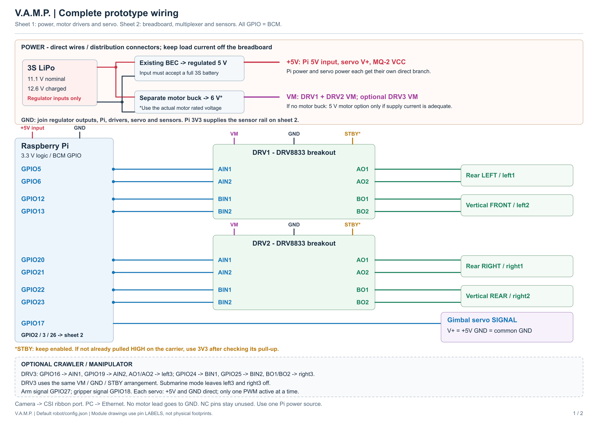
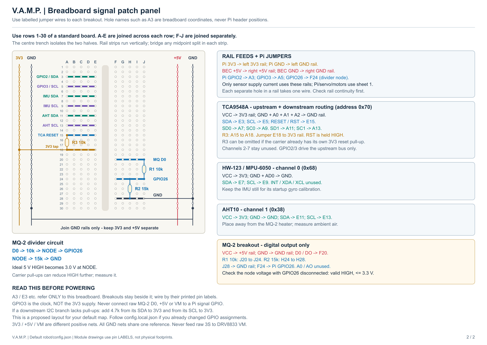

# Complete breadboard prototype

This guide combines the submarine motors, gimbal servo, HW-123, TCA9548A, AHT10 and MQ-2. Optional crawler and manipulator connections are included. It follows the **default BCM GPIO map** in `robot/config.json`; your ignored `robot/config.local.json` takes precedence if you changed that map. Make connections with all power off.

[Printable two-page A3 PDF](../output/pdf/vamp-breadboard-wiring.pdf) | [Power/motor diagram](breadboard-power-motors.png) | [Breadboard/sensor diagram](breadboard-sensors.png)





## How to read the breadboard drawing

Use the first 30 numbered rows of a standard breadboard. **A3 means column A, row 3 of the breadboard**, not physical pin 3 of the Pi. On each numbered row, A-E form one connected strip and F-J form another. The centre trench separates them. The coloured horizontal strips in the diagram show these existing internal connections; you do not add five jumper wires along each strip.

The left rail pair is **3V3 / GND**. The right rail pair is **5V / GND**. Feed 3V3 from the Pi's labelled 3V3 supply, 5V from the regulated BEC, and ground from the common reference. Join the two GND rails with an insulated jumper (shown from their bottom holes). Never join their positive rails. Bridge any midpoint breaks within each individual rail strip; verify continuity with power off because breadboards differ.

Breakouts sit beside the board and use labelled jumper leads. Their drawings are not verified physical footprints. Do not plug a module across strips without checking its actual pin spacing and labels. Each hole accepts one wire or component lead. Crossings without a junction dot are insulated wires passing over one another.

## Parts and supply branches

- One standard breadboard and jumper wires; female leads for existing male module headers as needed.
- Two complete DRV8833 boards for four thrusters; a third board if testing all six crawler motors.
- Existing 5 V BEC for the Pi, servo and MQ-2. Each Pi/servo feed and return branches directly at the supply distribution; do not run those loads through breadboard contacts.
- Separate motor buck set to **6 V only for motors rated for 6 V**, or the voltage actually rated for your N20 variant. Its VM feed, return and all motor leads stay off the breadboard. The earlier shared-5 V motor option is possible only if the supply handles the combined starting/stall load; this drawing separates the motor branch because of the earlier Pi resets.
- R1 = 10 kOhm and R2 = 15 kOhm for the MQ-2 divider. R3 = 10 kOhm for TCA RESET if its carrier lacks a reset pull-up. Ordinary 1/4 W resistors are sufficient for these signal circuits.
- If either downstream I2C branch lacks pull-ups, add about 4.7 kOhm from that branch's SDA to 3V3 and another from SCL to 3V3. Check the carrier components before adding more in parallel.

The 3S battery feeds only regulators whose inputs accept its full 12.6 V charge voltage. Genuine DRV8833 operating supply is 2.7-10.8 V, so raw 3S does not go to VM. BEC and motor-buck output grounds share the Pi/driver/sensor reference. Do not feed the Pi from a second USB supply while feeding its 5V header. 3V3, 5V and GND name supply pins; **GPIO3 is the I2C clock, not the 3V3 supply**.

## Exact breadboard connections

| Wire / component | Start | End |
| --- | --- | --- |
| Pi SDA | BCM GPIO2 | A3 |
| Mux upstream SDA | TCA SDA | E3 |
| Pi SCL | BCM GPIO3 | A5 |
| Mux upstream SCL | TCA SCL | E5 |
| Channel 0 SDA | TCA SD0 | A7 |
| IMU SDA | HW-123 SDA | E7 |
| Channel 0 SCL | TCA SC0 | A9 |
| IMU SCL | HW-123 SCL | E9 |
| Channel 1 SDA | TCA SD1 | A11 |
| AHT SDA | AHT10 SDA | E11 |
| Channel 1 SCL | TCA SC1 | A13 |
| AHT SCL | AHT10 SCL | E13 |
| Reset | TCA RESET / RST | E15 |
| Reset pull-up R3 (if needed) | A15 | A18 |
| Reset supply jumper | E18 | 3V3 rail |
| Raw comparator output | MQ-2 D0 / DO | F20 |
| Divider R1, 10 kOhm | J20 | J24 |
| Divider R2, 15 kOhm | H24 | H28 |
| Divider ground jumper | J28 | GND rail |
| Reduced comparator signal | F24 | BCM GPIO26 |

For example, F24, H24 and J24 are electrically joined inside that row. R1 and R2 therefore meet at the GPIO26 divider node, even though their legs use different holes.

| Board pin(s) | Supply / strap |
| --- | --- |
| TCA VCC / VIN | 3V3 rail |
| TCA GND, A0, A1, A2 | Separate wires to GND rail; address 0x70 |
| HW-123 VCC | 3V3 rail |
| HW-123 GND and AD0 | GND rail; address 0x68 |
| AHT10 VCC | 3V3 rail |
| AHT10 GND | GND rail; address 0x38 |
| MQ-2 VCC | 5V rail |
| MQ-2 GND | GND rail |
| MQ-2 A0 / AO | Unconnected; no ADC is installed |

The TCA A0/A1/A2 address straps are unrelated to MQ-2's A0 analog output. TCA channels 2-7 and HW-123 INT/XDA/XCL remain unused. If your HW-123 uses AD0 HIGH instead, configure address 0x69; the drawing assumes AD0 grounded.

With GPIO26 disconnected, measure the divider node in both comparator states. An ideal 5 V HIGH becomes 3.0 V; the breakout's own pull-up may lower it. Connect GPIO26 only after confirming a valid LOW/HIGH within the Pi's 3.3 V input range. If the actual divider cannot deliver a clean HIGH, use an appropriate 5 V-to-3.3 V logic interface. D0 gives a threshold state, not ppm or gas identity. Place the AHT10 away from the MQ-2 heater; condition the MQ-2 according to its manufacturer before interpreting its output.

## Motor and servo wires

| Board | Inputs from BCM GPIO | Motor output pair |
| --- | --- | --- |
| DRV1 A | AIN1 = 5; AIN2 = 6 | AO1/AO2 -> rear left / left1 |
| DRV1 B | BIN1 = 12; BIN2 = 13 | BO1/BO2 -> vertical front / left2 |
| DRV2 A | AIN1 = 20; AIN2 = 21 | AO1/AO2 -> rear right / right1 |
| DRV2 B | BIN1 = 22; BIN2 = 23 | BO1/BO2 -> vertical rear / right2 |
| Optional DRV3 A | AIN1 = 16; AIN2 = 19 | AO1/AO2 -> crawler left3 |
| Optional DRV3 B | BIN1 = 24; BIN2 = 25 | BO1/BO2 -> crawler right3 |

Every driver: VM to the regulated motor branch; GND to the common ground. Keep its carrier's STBY enable HIGH. If not already pulled HIGH, connect it to 3V3 only after checking that no carrier pull-up would join a higher supply to the Pi rail. NC pins remain unconnected. Use the **printed pin labels** on your red carrier: the photographed right-hand output order was AO1, AO2, BO2, BO1, which differs from the functional order drawn here. A motor connects across its output pair; neither lead is permanently grounded. The first four channels also drive crawler motors when the crawler module is installed; the software profile changes the mixing.

Gimbal: signal to **BCM GPIO17**, V+ directly to regulated 5 V, GND directly to common ground. Optional arm/gripper signals are GPIO27/GPIO18, with the same supply arrangement. Use the servo's actual connector pinout. The software activates only one servo PWM signal at a time; the default release does not guarantee holding torque. Servos do not connect through the TCA or DRV8833. The environment front connector already uses all six contacts, so use a separate gimbal lead.

Camera ribbon goes to the Pi CSI port; Ethernet goes to the PC. Neither goes through the breadboard. For detachable side/front contact assignments see [submarine wiring](submarine-minimum-wiring.md) and [environment wiring](environment-wiring.md).

## Bring up the prototype

1. With power off, check rail separation/continuity, resistor values, module labels and the common ground. Initially leave motor and servo positive supply disconnected.
2. Check regulator outputs before attaching the Pi or sensors. Bring up the Pi and sensors first. Measure MQ-2 divider LOW/HIGH before connecting GPIO26.
3. In the Pi's existing VAMP directory, enable I2C and the routed sensors:

   ```bash
   sudo systemctl stop vamp
   git pull --ff-only
   sudo raspi-config nonint do_i2c 0
   .venv/bin/python -m pip install -r robot/requirements.txt
   .venv/bin/python tools/configure_environment.py --enable --mq2-gpio 26
   .venv/bin/python tools/configure_imu.py --enable --address 0x68
   sudo systemctl start vamp
   journalctl -u vamp -n 40 --no-pager
   ```

   These helpers require your existing `robot/config.local.json` and preserve motor wiring and token. The environment helper sets IMU channel 0 and AHT10 channel 1. The IMU helper enables the existing IMU reader. Keep it still during startup calibration. See the [environment guide](environment-wiring.md#check-i2c-routing) for channel-by-channel scans.
4. Verify temperature, humidity and orientation while disarmed. Shut down and remove power before reconnecting servo/motor supplies. Then test one actuator at a time with the mechanism supported and propellers unloaded; confirm directions before enabling stabilization.

The drawings are checked against the repository's default map, not your physical assembly. No new runtime code or Windows executable is required for this documentation update.

## References and regeneration

[TI DRV8833 datasheet](https://www.ti.com/lit/ds/symlink/drv8833.pdf), [TI TCA9548A](https://www.ti.com/product/TCA9548A), [Raspberry Pi GPIO documentation](https://www.raspberrypi.com/documentation/computers/raspberry-pi.html), [Winsen MQ-2 specifications](https://www.winsen-sensor.com/product/mq-2.html?by=mq-sensor), and [Aosong AHT10 manual](https://dinistor.ru/files/AOSONG_AHT10_EN.PDF).

The editable SVGs are generated with `python tools/draw_breadboard_wiring.py`. Render each to a 3600-pixel-wide PNG with an SVG renderer, then run `python tools/draw_breadboard_wiring.py --pdf` with ReportLab installed to recreate the two-page printable PDF.
