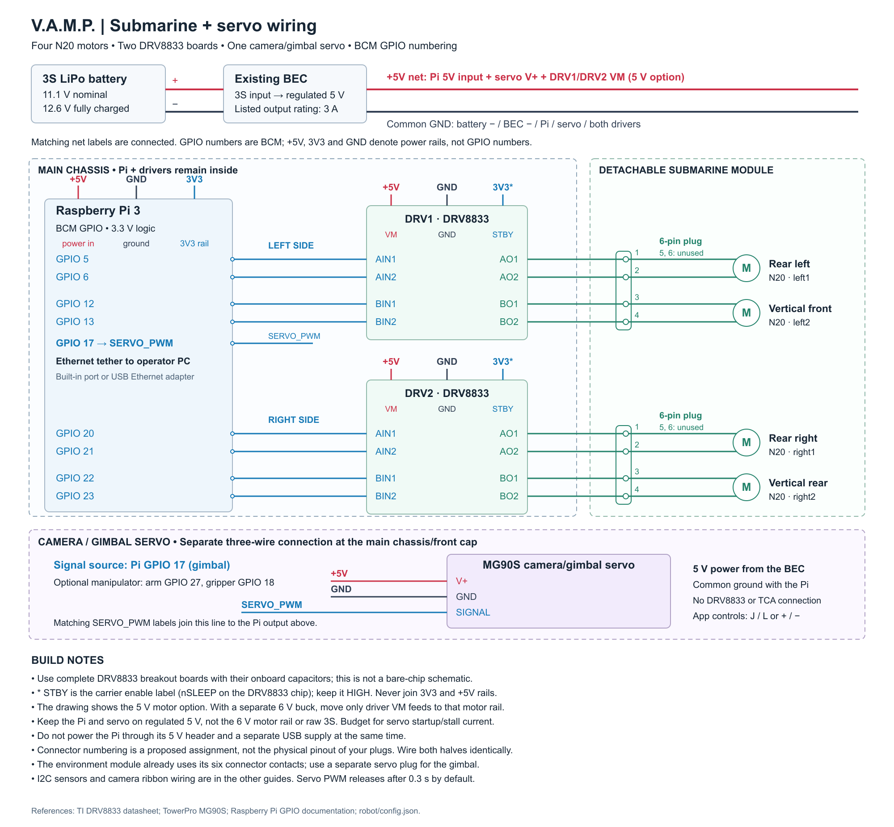

# Submarine and gimbal servo wiring

This is a proposed four-motor plus camera/gimbal-servo connection diagram matching the current `submarine` profile and `servos.gimbal` entry in `robot/config.json`. It uses complete DRV8833 breakout boards in the main chassis. It is not a bare-chip schematic or a verified physical layout of the particular boards and connectors you own. All GPIO numbers are BCM.

## Power

| From | To |
| --- | --- |
| 3S LiPo positive | Existing BEC input positive |
| 3S LiPo negative | BEC input negative |
| Regulated BEC +5 V | Pi 5V input, servo V+, DRV1 VM and DRV2 VM for the 5 V motor option |
| BEC output ground | Pi GND, servo GND, DRV1 GND, DRV2 GND |
| Pi 3V3 rail | Driver STBY/enable inputs if not already held HIGH on the carrier |

The BEC input/output negative is the common reference in this non-isolated UBEC arrangement. Read board labels before wiring: carrier names can differ from chip signal names. If nSLEEP is already pulled high on the carrier, leave that carrier connection intact rather than joining a 5 V pull-up directly to the Pi 3.3 V rail. Do not connect a second USB power supply while feeding the Pi through its 5 V header.

The drawing retains the 5 V motor-supply option. If using a separate 6 V motor buck, connect only the DRV8833 VM inputs to that motor rail, keeping the servo and Pi on regulated 5 V and all grounds common. Do not move the servo supply to raw 3S. The BEC's capacity must accommodate the Pi and servo starting/stall load (plus motors if sharing that rail). A fully charged conventional 3S LiPo is 12.6 V; it cannot directly supply a genuine DRV8833. [TI DRV8833 datasheet](https://www.ti.com/lit/ds/symlink/drv8833.pdf).

## Camera and gimbal servo

| Servo connection | Destination |
| --- | --- |
| Signal | Pi **GPIO17** by default |
| Positive supply / V+ | Regulated **5 V BEC rail** |
| Ground / GND | Common BEC/Pi ground |

Use the servo's connector markings/pinout; do not rely only on wire colour. Its positive supply is not a GPIO output or the 3V3 rail. The PWM signal goes directly from the Pi to the servo, not through the TCA9548A or DRV8833. Use a separate three-wire connection at the main chassis/front cap: the environment module's existing six-pin connector has no unused contacts.

The existing code already controls the gimbal on GPIO17 with **J/L** or the Gimbal +/- buttons after ARM. If your local configuration uses another pin, follow its `servos.gimbal` value instead. If you meant a manipulator servo, the existing defaults are **GPIO27 for arm** and **GPIO18 for gripper**; select the manipulator attachment for those controls. Only one servo PWM signal is enabled at a time. The default 0.3-second release detaches the signal and does not guarantee holding torque.

## Pi to driver inputs

All GPIO numbers below are **BCM**, not physical header numbers. [Raspberry Pi GPIO documentation](https://www.raspberrypi.com/documentation/computers/raspberry-pi.html).

| Motor | Board/channel | GPIO → input |
| --- | --- | --- |
| Rear left (`left1`) | DRV1 A | GPIO5 → AIN1; GPIO6 → AIN2 |
| Vertical front (`left2`) | DRV1 B | GPIO12 → BIN1; GPIO13 → BIN2 |
| Rear right (`right1`) | DRV2 A | GPIO20 → AIN1; GPIO21 → AIN2 |
| Vertical rear (`right2`) | DRV2 B | GPIO22 → BIN1; GPIO23 → BIN2 |

Connect each motor's two wires across its channel's OUT1 and OUT2 outputs. Neither motor terminal connects permanently to ground; the H-bridge reverses both terminals. AIN/BIN are logic inputs, while AOUT/BOUT are motor outputs.

## Proposed connector assignment

Each side's six-pin plug carries two independent motor-output pairs. These are proposed logical pin numbers; identify the actual connector cavities and mirror the assignment correctly on both halves.

| Connector pin | Left connector from DRV1 | Right connector from DRV2 |
| --- | --- | --- |
| 1 | AOUT1 → rear left motor lead 1 | AOUT1 → rear right motor lead 1 |
| 2 | AOUT2 → rear left motor lead 2 | AOUT2 → rear right motor lead 2 |
| 3 | BOUT1 → front vertical motor lead 1 | BOUT1 → rear vertical motor lead 1 |
| 4 | BOUT2 → front vertical motor lead 2 | BOUT2 → rear vertical motor lead 2 |
| 5, 6 | Unused | Unused |

With drivers in the chassis, this connector carries switched motor power, not a serial data link or a shared +5 V/GND pair. The two vertical motors are assumed to be separated front to rear, matching the software's pitch mixer. Reverse a motor with `invert_motors` if its actual installation turns the opposite way.

Connect the Pi to the PC over the Ethernet tether, select **submarine** in the app, and map/confirm the actual GPIO wiring in `robot/config.local.json` before enabling hardware mode. Camera ribbon wiring and the I2C sensor wiring are covered separately. IMU stabilization remains disabled by default until configured and selected. No depth-hold sensor is implied.
